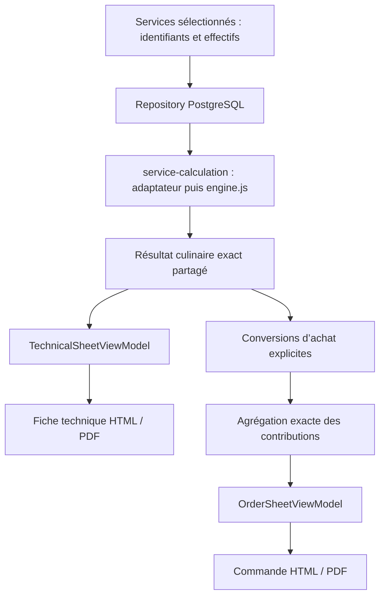
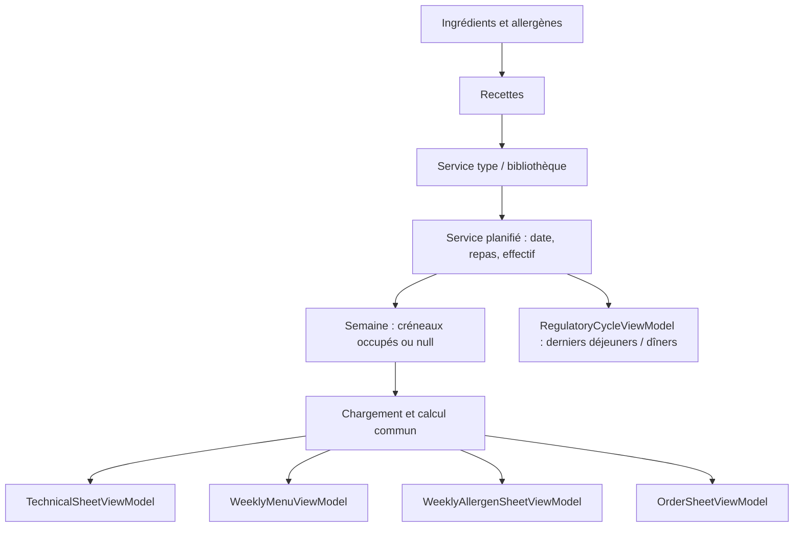

# Architecture métier du moteur V0

Version de référence figée le 3 octobre 2026. Quatre services validés, sans interface PWA, base de données ni design A4. Ce document décrit le contrat métier actuel et distingue les extensions futures des fonctions réellement implémentées.

## Flux de calcul

```text
effectif + identifiant du service
  → validation et sélection des données
  → répartition des portions (split / all)
  → composants et périmètres (covers / meat / fish)
  → résolution des règles de quantité (recette > profil > générique explicite)
  → unités de production / préparations communes et allocations
  → quantités exactes des ingrédients et rendements
  → arrondis d’affichage, à partir des valeurs exactes
  → présentation Markdown ; plus tard PWA ou fiche A4/PDF
```

Les préparations communes sont calculées avant les composants qui les consomment. Les unités de production sont déterminées avant les ingrédients des recettes calculées par unité. L’arrondi physique des unités et la répartition entière des portions sont des décisions métier ; ils ne sont pas des arrondis d’affichage.

## 1. Service

Un service est l’ensemble cohérent des composants proposés pour un effectif. La définition persistable contient `id`, `name`, `baseCovers`, `portionMode`, `recipes`, éventuellement `preparations`, `profiles` et `genericRules`, ainsi que `sauceRules` (objet vide si absent du scénario).

L’effectif réel n’est pas stocké dans la définition : il est fourni à `calculate(effectif, serviceId)`. Le résultat contient `covers`, `serviceId`, `serviceName`, `portions`, `recipes`, `preparations` et `sauceRules`.

Les services opérationnels actuels sont mixtes viande/poisson ou végétariens à 100 %. Aucun service viande seule n’est défini. La possibilité technique de nommer les groupes ne constitue pas un nouveau scénario métier validé.

`baseCovers` est une information de référence du service. Le moteur utilise les bases propres aux recettes et aux règles ; il ne leur substitue pas automatiquement `baseCovers`.

## 2. Composant et catégories fonctionnelles

Un composant est un plat ou un élément nommé : carbonnade, limande, frites, carottes, beurre blanc, lasagnes, salade, vinaigrette, etc.

En V0, composant et recette sont représentés ensemble dans chaque entrée de `recipes`. Le composant apporte identité, classement, liens et périmètre ; la recette apporte ingrédients, bases et règles. Cette fusion est assumée pour la V0, sans prétendre à deux entités déjà séparées.

Les chemins de classement sont : Protéine > Viande, Protéine > Poisson, Protéine > Végétarien, Féculent, Légume et Sauce. Les marqueurs complémentaires actuels sont Plat complet, Finition et Préparation commune.

`category` conserve un chemin principal historique ; `categories` permet plusieurs chemins. Le résultat normalise l’absence de `categories` en `[category]`. Une lasagne peut être simultanément Protéine > Viande, Féculent et Légume.

**Les catégories servent à classer. Elles ne déclenchent aucun grammage.** La sélection d’une règle générale est explicite avec `genericRule`, indépendamment de `category`. Les clés historiques `Légume` et `Sauce` du dictionnaire de règles sont des identifiants choisis, pas une inférence du moteur. Les catégories supplémentaires d’un plat complet ne génèrent pas des quantités additionnelles.

## 3. Recette et périmètre

Une recette décrit une référence exacte, ses ingrédients et son redimensionnement. Champs actuels :

| Champ | Responsabilité |
|---|---|
| `id`, `name` | Identité dans le service |
| `scope` | Périmètre : `covers`, `meat`, `fish` actuellement utilisés |
| `basePortions` | Portions ou couverts de référence, pour calcul par portions |
| `baseProductionUnits` | Unités physiques de référence, pour calcul par production |
| `ingredients` | Quantités de référence, unités ou liens vers préparation |
| `profile`, `genericRule`, `rules` | Sélection et surcharge des règles |
| `targetYield` | Rendement cible de référence, distinct des ingrédients |
| `linkedTo` | Lien descriptif vers un autre composant |
| `notes`, `allergens` | Consignes et allergènes actuellement connus |

Les étapes de préparation sont actuellement des consignes libres dans `notes`, pas un modèle structuré d’étapes. Un futur champ d’étapes pourra être ajouté sans entrer dans le calcul des quantités.

Le lien `linkedTo` ne pilote pas seul le calcul : le beurre blanc suit le poisson parce que son `scope` vaut `fish`. Les liens doivent rester cohérents avec les périmètres.

## 4. Modes de portions

### SPLIT

```js
{ type: 'split', roundedGroup: 'fish', complementGroup: 'meat', ratio: '0.3' }
```

Le groupe arrondi reçoit l’entier le plus proche de `effectif × ratio` ; une moitié exacte va à l’entier supérieur. L’autre groupe est le complément à l’effectif. Pour les services actuels, le groupe arrondi est le poisson : 15 donne 10 viande / 5 poisson ; 181 donne 127 / 54.

Le moteur travaille sur deux groupes paramétrés. Les portions restent des entiers, leur total égale l’effectif, et aucune proportion n’est appliquée à une valeur d’affichage. Le ratio d’une définition valide doit être compris entre 0 et 1 ; la validation exhaustive du schéma de données n’est pas encore implémentée.

### ALL

```js
{ type: 'all', group: 'vegetarian' }
```

Tous les couverts sont affectés au groupe indiqué. Les composants du couscous ont `scope: 'covers'`. Aucun calcul 70/30 n’est appliqué à ce service.

## 5. Règles de quantité et surcharge

Le calcul d’un ingrédient de référence est :

```text
quantité exacte = quantité de référence × effectif du périmètre / base de référence
```

Une règle `portionQuantity` peut générer un ingrédient avec son nom, sa quantité, son unité et sa base (1 par défaut). Une règle `targetYield` décrit un rendement, pas une masse ou un volume d’ingrédient supplémentaire.

| Exemple validé | Quantité / périmètre |
|---|---|
| Frites | 200 g / couvert |
| Légumes cuits standards | 120 g / couvert |
| Salade | 50 g / couvert |
| Semoule crue | 80 g / couvert |
| Vinaigrette légère | 15 ml / couvert |
| Limande | 1 unité / portion poisson |
| Merguez végétales | 2 pièces / couvert |

L’ordre est **règle spécifique de recette > profil > règle générique explicitement sélectionnée**. `resolveRules` remplace chaque règle complète, sans fusion récursive de ses champs. Les autres règles non remplacées restent disponibles.

Le champ historique `recipe.targetYield` est traité comme une règle spécifique et prime sur le profil ; `recipe.rules.targetYield` peut à son tour le remplacer. Les ingrédients explicitement présents dans la recette sont conservés : une surcharge `portionQuantity` ne réécrit pas leur liste. Éviter de définir deux fois le même besoin, en ingrédient et en règle génératrice.

La salade remplace la règle 120 g par 50 g. Le profil vinaigrette remplace le rendement de sauce chaude. Courgettes et champignons pourront recevoir leur propre règle plus tard ; aucun grammage supplémentaire n’est inventé en V0. Les surcharges d’arrondi d’affichage par recette restent futures.

## 6. Unité de production

Une règle `production` décrit `name`, `unit`, `portionsPerUnit`, `rounding`, et éventuellement `itemsPerUnit`, `itemName`, `itemUnit`.

```text
unités produites = ceil(portions demandées / capacité par unité)
sous-unités = unités produites × sous-unités par unité
capacité produite = unités produites × capacité par unité
```

`rounding` est explicite dans les deux services concernés. Seule la stratégie `ceil` est actuellement prise en charge ; l’absence du champ conserve ce défaut. Une autre stratégie est rejetée, pas silencieusement appliquée. D’autres stratégies nécessiteront implémentation et tests.

`ingredientBasis` choisit indépendamment la base des ingrédients :

- `portions` par défaut : ingrédients au prorata des portions, sur `basePortions`.
- `productionUnits` : ingrédients au prorata des unités physiques produites, sur `baseProductionUnits`.

Lasagnes : bac GN 1/1 de 10 portions, 4 plaques par bac ; les ingrédients restent sur les portions demandées conformément au scénario validé. Quiches : plaque de 10 portions ; ingrédients par plaque réellement produite. À 103 couverts, 72 portions lard donnent 8 plaques et exactement 4,8 kg de lardons. Le surplus de capacité n’est pas ajouté à l’effectif du service, ni à la salade ou à la vinaigrette.

Le calcul supérieur utilise des entiers BigInt ; les ingrédients par unité reprennent cet entier exact, pas `display`. Zéro portion donne zéro unité. Les sous-unités sont facultatives.

## 7. Préparation commune et allocation

`preparations` contient les recettes fabriquées une fois. Chaque préparation possède une base, un périmètre, des ingrédients, un rendement et une liste `allocations`. Une allocation contient `to` (identifiant du composant), quantité de référence et unité ; sa base vaut celle de la préparation sauf surcharge explicite.

Un ingrédient de composant portant `fromPreparation` reprend l’allocation exacte associée à ce composant. L’absence du lien d’allocation provoque une erreur. Le moteur ne fabrique pas une recette de préparation supplémentaire par plat.

Béchamel : une recette à 12 L/100 couverts, avec 8 L pour bolo et 4 L pour saumon. À 160 : 19,2 L, alloués en 12,8 L et 6,4 L. À 103 : 12,36 L exacts, alloués en 8,24 L et 4,12 L.

**Décision validée :** l’allocation suit l’effectif total. Le prélèvement saumon ne doit pas être recalculé à 4 L/30 portions lorsque la répartition entière diverge. L’allocation commune est la source de vérité des deux plats.

Les ratios 8/12 et 4/12 sont représentés par les volumes de référence 8 et 4, pas par un mécanisme autonome de partage de ratios. Les allocations surchargeables à l’exécution restent futures. Le moteur ne prend pas en charge un graphe de préparations imbriquées ; les préparations calculées avant les plats sont le périmètre V0.

Pour un futur total d’achats, compter les ingrédients de préparation une fois et exclure les prélèvements internes des plats. Les tests garantissent que les allocations actuelles totalisent le rendement ; une validation universelle des sommes d’allocation n’est pas encore exécutée à chaque appel.

Le Grana de finition est un composant séparé à 500 g/100 couverts, en plus du Grana contenu dans la béchamel.

## 8. Profils de sauce

| Profil validé | Base de calcul |
|---|---|
| Viande séparée | 5 L / 70 portions viande |
| Poisson séparée | 2,5 L / 30 portions poisson |
| Chaude commune | 7,5 L / 100 couverts |
| Mijoté déjà en sauce | Sauce intégrée + 2,5 L / 70 portions viande en supplément de service |
| Vinaigrette légère | 15 ml / couvert |

La catégorie Sauce ne sélectionne pas le profil. Celui-ci provient de la recette, de son profil ou d’une règle générale explicitement choisie.

Les quatre alternatives chaudes du service initial sont conservées dans `sauceRules`. Elles ne s’additionnent pas. La carbonnade utilise `serviceSauceRule: 'stewExtra'` ; le volume intégré au plat n’est pas estimé à partir des liquides crus. Le beurre blanc porte sa propre recette et son rendement poisson ; la sauce couscous son rendement tous couverts. La vinaigrette utilise son propre profil, jamais les alternatives chaudes.

Le rendement cible d’une sauce n’est pas calculé en additionnant masses et volumes d’ingrédients. Les volumes de service approximatifs restent des hypothèses de recette, même lorsque leur redimensionnement mathématique est exact.

## 9. Quantités exactes et arrondis

Les données numériques de recette sont des chaînes décimales. Le calcul les transforme en fractions réduites d’entiers BigInt. Le résultat JSON contient :

```js
{ exact: { numerator: '192', denominator: '1' }, unit: 'g', display: '190 g' }
```

Les chaînes évitent les pertes liées aux nombres flottants et rendent le résultat sérialisable. QS donne `exact: null`, `unit: 'QS'`, `display: 'QS'`, même à effectif nul. QS ne vaut pas zéro.

| Unité | Pas d’affichage |
|---|---|
| kg, L | 0,1 |
| g, ml | 10 |
| unités, pièces, portions, bacs, plaques | 1 |

La moitié exacte est arrondie vers le haut. Exemples : 4,76 kg → 4,8 kg ; 238 g → 240 g ; 1,05 kg → 1,1 kg ; 21 g → 20 g ; 51 limandes → 51 unités.

Les unités de référence sont conservées, sans conversion automatique : les normalisations g vers kg nécessaires aux recettes sont faites exactement dans les données. Le formateur utilise actuellement l’entier pour les autres unités ; une liste strictement validée d’unités reste à prévoir avant d’élargir le catalogue.

**Ne jamais utiliser `display` comme entrée métier.** L’arrondi des portions et le `ceil` de production définissent des entiers métier exacts ; tous les redimensionnements suivants utilisent ces valeurs exactes. La précision de calcul ne garantit pas la précision physique d’une fabrication.

## 10. Ingrédient : état V0 et cible V1

En V0 : nom libre, quantité de référence, unité ; exceptionnellement `fromPreparation`. Les allergènes connus sont au niveau recette, sans catalogue complet ni déduction automatique.

La V1 pourra introduire un catalogue d’ingrédients avec identifiant et nom normalisé, unité, catégorie d’achat, allergènes, conditionnement et règle d’arrondi éventuelle. Ces champs sont conceptuels, pas encore implémentés. Fournisseur et traces éventuelles sont exclus du périmètre demandé.

## 11. Séparation des couches

**Domaine métier :** définitions de service et recettes, résolution des règles, portions, production, allocations, fractions exactes et politiques d’arrondi. `engine.js` expose le même résultat aux tests, commandes et futurs consommateurs.

**Présentation :** `display.js` transforme le résultat en Markdown sans calcul de grammage. Les futures PWA et fiches A4/PDF consommeront ce résultat ; aucune valeur rendue ne reviendra dans le moteur comme base de calcul. Le formateur numérique est actuellement exposé par le moteur car il applique une politique métier d’affichage, tandis que l’organisation du document est dans la présentation.

**Données persistantes :** modules JavaScript locaux et registre `services.js` en V0. Aucune base de données. Un futur adaptateur pourra charger des définitions depuis une base ; le moteur ne devra dépendre ni de l’interface ni du stockage. Aujourd’hui, il importe directement le registre : l’injection d’un catalogue sera une extension structurelle future, pas une capacité déjà disponible.

Utilisation indépendante actuelle : `calculate(181, 'lasagnes')`, ou `calculate(100)` pour le service historique. L’effectif est un entier positif ou nul dans la plage des entiers sûrs JavaScript ; un identifiant inconnu est rejeté. Les consommateurs ne doivent pas modifier le catalogue partagé.

## 12. Fichiers et responsabilités

| Fichier | Responsabilité |
|---|---|
| `engine.js` | Calcul exact, répartition, règles, production, préparation/allocation, arrondis numériques |
| `services.js` | Registre des quatre services |
| `service.js` | Données Carbonnade/Limande, recettes et alternatives de sauce |
| `couscous.js` | Données du service végétarien |
| `lasagnes.js` | Données lasagnes, béchamel commune, profils et surcharges |
| `quiches.js` | Données par plaque, profils et surcharges |
| `display.js` | Rapport Markdown et commande d’affichage |
| `tests.js` | Jeux de non-régression et invariants transversaux |
| `ARCHITECTURE.md` | Contrat métier, choix, limites et évolutions conceptuelles |
| `README.md` | Commandes et exemples d’utilisation |
| `resultats.md` | Rapport Carbonnade/Limande |
| `resultats-couscous.md` | Rapport couscous |
| `resultats-lasagnes.md` | Rapport lasagnes |
| `resultats-quiches.md` | Rapport quiches |

Les rapports sont générés ; ils ne constituent pas les données de référence du moteur.

## 13. Incohérences et décisions structurelles

Petites corrections faites lors de cette documentation, sans changement des quantités validées :

- Sélection de règle générique par `genericRule`, au lieu d’une inférence de `category`. Les catégories sont désormais uniquement descriptives.
- Stratégie `rounding: 'ceil'` explicite dans les données de production ; validation des stratégies prises en charge.
- Suppression du champ historique `service.allocation`, inutilisé et redondant avec `portionMode`. Le terme allocation est réservé aux préparations communes.

Points de nommage ou de responsabilité conservés pour éviter une refonte : `service.js` est moins explicite que `carbonnade-limande.js` ; `recipes` fusionne composant et recette ; `category` et `categories` coexistent ; les règles génériques portent des noms de catégorie bien qu’elles soient désormais sélectionnées explicitement ; `sauceRules` et `profiles` représentent deux formes historiques de profils. Aucun de ces renommages n’est nécessaire pour le résultat métier actuel.

Les profils et certaines recettes d’accompagnement sont répétés dans les fichiers de service. Un regroupement partagé pourra être utile, mais doit préserver la possibilité de surcharge locale. Ne pas uniformiser les bases d’ingrédients des lasagnes et quiches : leur différence est une décision métier validée.

Limites à traiter avant extension importante : validation exhaustive du catalogue, sommes et destinations d’allocation, stratégies supplémentaires, étapes structurées, catalogue d’ingrédients, stockage injecté. Ces limites ne justifient pas une refonte ou un nouveau service dans cette tâche.

## 14. Jeux de non-régression

| Service | Effectifs centraux | Abstractions protégées |
|---|---|---|
| Carbonnade/Limande | 15, 100, 160, 170, 181 | SPLIT, égalités poisson, ingrédients exacts, sauces liées, QS, accompagnements tous couverts |
| Couscous végétarien | 80, 100, 160 | ALL, pièces entières, ratios semoule, sauce proportionnelle, distinction légumes sauce/garniture |
| Lasagnes | 100, 160, 181, 103 | Bacs `ceil`, 4 plaques/bac, ingrédients sur portions, préparation commune, allocations, finition, profils et surcharges |
| Quiches | 100, 160, 181, 103 | Plaques `ceil`, ingrédients sur unités produites, salade et vinaigrette sur effectif, isolation des modes |

Les tests transversaux vérifient notamment le total des portions jusqu’à 10 000 couverts, un grand effectif, les égalités exactes, les seuils d’affichage, les fractions, le zéro et les entrées invalides. Les quiches sont également parcourues jusqu’à 1 000 couverts.

Ces quatre jeux doivent rester ensemble : ils empêchent qu’une nouvelle abstraction casse une ancienne base de calcul. Les tests de priorité incluent désormais l’absence de règle induite par la catégorie et l’indépendance vis-à-vis du classement. Les tests de production incluent la stratégie explicite et le rejet d’une stratégie non supportée.

```sh
node --test tests.js
```

La suite V0 comprend 16 tests. Aucun nouveau service n’a été ajouté lors du gel documentaire.

## 15. Cas futur, non implémenté

Hachis Parmentier + Brandade de morue avec purée commune servira à revalider préparation commune et allocation pour une garniture partagée. Ne pas créer ses données, recettes ou règles maintenant. Ce cas devra aussi préciser l’effet des portions arrondies sur les allocations avant son intégration.

## 16. Contrat actuel : fiches techniques et commandes

Cette section décrit l’architecture implémentée après les extensions PostgreSQL et remplace les perspectives historiques des sections 10 et 11 concernant le stockage. Le catalogue d’ingrédients, les recettes, composants et profils sont désormais persistants. Les rapports, JSON et PDF sont des sorties dérivées, jamais des sources de quantités.

Une fiche technique et une commande sont deux projections des mêmes données et du même calcul exact. La commande ne dépend pas du PDF ou des quantités arrondies de la fiche ; elle consomme le résultat structuré qui sert aussi à produire cette fiche.



### Source unique et recalcul

`persistence/service-calculation.js` centralise le chargement d’un service existant, son adaptation et l’appel au moteur inchangé. Les pipelines techniques et commandes l’utilisent tous deux. Chaque appel recharge les données : changer un effectif, une quantité de recette, un composant ou un profil est pris en compte à la génération suivante. Aucun cache de total de commande n’est utilisé.

L’entrée publique des commandes accepte uniquement une liste de sélections `serviceId`, `headcount`, `serviceDate`, `mealType`. Les listes d’ingrédients injectées sont refusées ; un identifiant de service absent est rejeté. Les modules purs de conversion et d’agrégation restent des étapes internes, utiles aux tests. Aucune table indépendante `technical_sheet_ingredients` ou `order_ingredients` n’est créée.

### Traçabilité et navigation future

Chaque contribution d’achat conserve l’identifiant du service, du composant (ou de la préparation commune et de ses composants destinataires), de la recette persistante et de la recette du domaine. Elle conserve aussi la relation recette-ingrédient ou le profil source, l’ingrédient culinaire, sa fraction exacte et son unité, les étapes de conversion avec leurs ratios, puis l’ingrédient acheté et sa fraction exacte. QS reste QS. Les transferts de préparations communes ne sont pas achetés une seconde fois.

Le modèle de fiche expose `orderSelection` et les références persistantes de chaque bloc. Le modèle de commande expose ses services sélectionnés et les sources de chaque ligne. Ces références permettent à une future interface de passer d’une fiche à sa commande, d’un jour ou d’une semaine à une liste de sélections, puis d’une ligne d’achat aux fiches et composants contributeurs. Aucun écran ou routage n’est développé ici.

Les unités d’achat, conversions, agrégation et arrondis existants restent inchangés. Les étapes de conversion sont désormais conservées comme métadonnées ; elles ne sont pas rejouées pour reconstruire un calcul depuis l’affichage.

### Vérifications du lien

`orders/service-linkage.test.js` protège les changements d’effectif et de recette, l’égalité des besoins culinaires avec les fiches des quatre services, les sommes exactes de deux services et de quatorze services sur une semaine, les références persistantes et les conversions, ainsi que le refus de saisies indépendantes d’ingrédients. Les tests utilisent une base temporaire ; les mutations de scénario ne modifient pas la base de référence.

## 17. Projection allergènes hebdomadaire

`WeeklyAllergenSheetViewModel` est la troisième projection du socle partagé, après les vues cuisine et achat. Son pipeline recharge les mêmes services via `service-calculation`, conserve les identités des ingrédients culinaires et agrège leurs relations `ingredient_allergens` par composant. Les préparations communes transmettent leurs allergènes aux composants destinataires. Aucun allergène saisi au niveau de la semaine et aucune nouvelle table métier ne sont nécessaires.

Le modèle expose sept jours et deux créneaux, les composants et leurs références, catégories fonctionnelles, allergènes ordonnés, traces séparées, sources ingrédients et statuts à vérifier. Une modification de recette ou de relation ingrédient/allergène se reflète au prochain calcul. La légende est désormais fixe : les 14 allergènes du référentiel, dans leur ordre stable. Les listes par plat restent limitées aux allergènes réellement calculés.

`weekly-allergens/visuals.js` centralise les 14 identifiants, libellés, SVG, couleurs et ordre. Le template rend ces attributs sans reconnaître les noms. Les couleurs de composants suivent les fonctions du repas : protéine rouge, féculent orange, légume vert, sauce bleu. Les plats complets suivent la fonction principale. La finition Grana suit le plat principal ; cette convention de présentation est documentée, sans changement de catégorie en base.

V1 affiche uniquement CONTIENT. La base actuelle ne stocke pas encore un type contient/traces ; ses associations existantes sont interprétées comme contient. `traces` est préparé dans le modèle mais reste vide et exclu du rendu principal. Le stockage ultérieur des traces devra rester lié aux ingrédients, jamais à une saisie indépendante de fiche. La complétude des ingrédients reste visible dans le modèle et signalée dans le document.

Le template HTML/CSS est responsive, avec priorité A4 paysage. L’export refuse un contenu qui dépasse les cases, plutôt que de couper des lignes ou réduire silencieusement la police. La démonstration réemploie les services persistés et le planning de la commande semaine. Voir `weekly-allergens/README.md` pour l’API, les limites et les conventions de présentation.

## 18. Planification officielle : bibliothèque → occurrences → semaines

Cette section remplace les démonstrations antérieures qui répétaient des services pour remplir une semaine. `services` est le catalogue de fiches types ; `service_templates` en est une vue. `weeks` organise sept jours, tandis que `planned_services` porte les occurrences réelles, leur date, repas, référence de type et effectif. Une semaine possède quatorze cases potentielles, jamais quatorze services obligatoires.



La migration 007 réutilise les tables de types et semaines existantes, ajoute les occurrences, conserve les anciennes affectations complètes et refuse les affectations incohérentes. Les anciennes API restent utilisables pour une prévisualisation de bibliothèque ; les API de planification prennent des identifiants d’occurrence ou de semaine. Les semaines ne sont jamais remplies automatiquement. La démonstration ne contient que quatre affectations explicites de 100 couverts, soit 400 couverts ; dix cases restent null.

`PlanningRepository` prépare la future interface : création d’une semaine vide, bibliothèque recherchable, affectation d’un type à un créneau et modification de son effectif. Aucun écran PWA n’est créé. Une sélection d’achat explicite peut contenir une ou plusieurs occurrences distinctes. La commande semaine prend exactement celles enregistrées dans la semaine. Une semaine vide produit zéro service et zéro couvert, sans commande PDF fictive.

Seuls les composants `menu_visible` sont affichés dans menu/allergènes. `component_menu_contributions` transmet les allergènes des finitions internes à leurs plats destinataires ; les préparations communes suivent leurs relations d’allocation existantes. Le Grana de finition n’est plus un plat autonome, mais ses quantités et sa contribution d’achat restent intégralement calculées. Ces propriétés de présentation ne modifient ni les recettes ni les règles du moteur.

Historique : les occurrences à préparer chargent les types courants. La clôture explicite `markServed` fige automatiquement un snapshot des entrées persistantes utilisées, sans saisie indépendante et sans totaux d’affichage comme vérité. Une occurrence servie est immuable et se recalcule depuis ce snapshot ; les changements ultérieurs de bibliothèque affectent uniquement les occurrences non clôturées. Il faudra conserver une version exécutable du moteur si celui-ci évolue ultérieurement. La date passée seule ne déclenche aucune clôture automatique.

Les cycles futurs interrogent les occurrences réelles, séparément pour lunch et dinner, et récupèrent les vingt derniers repas au plus. Le filtre servedOnly distingue historique servi et planning futur. Les structures regulation_rule_sets / regulation_rules / rule_versions restent vides ; le ViewModel expose la complétude sans inventer de conformité ni de seuil. Les futures évaluations devront donner des résultats détaillés par règle et version.

Voir `planning/README.md` pour les responsabilités, la migration, les API, les conventions d’historique et les limites. Les tests de planification complètent les non-régressions existantes ; engine.js, recettes, quantités, conversions et catégories d’achat restent inchangés.


## 19. Légende fixe et couleurs des 14 allergènes

Le référentiel de présentation allergenVisuals associe désormais quatorze couleurs distinctes et quatorze SVG spécifiques. Le lait est violet et le poisson bleu. Le template utilise exclusivement ces SVG et les attributs fournis ; aucun choix de couleur allergène n’est déduit d’un nom.

La légende est fixe dans l’ordre des quatorze identifiants, indépendamment de la semaine. Elle est disposée en deux lignes de sept avec pictogrammes de 6 mm et texte de 8,5 pt. Les composants gardent uniquement les allergènes réellement calculés, leurs propres listes et des pictogrammes de 5 mm. Le calcul contient/traces et le modèle métier restent inchangés. Les tests protègent l’ordre, les couleurs distinctes, le contraste blanc/fond, la conformité des fichiers SVG, la légende sur une semaine vide et l’identité visuelle entre cases et légende.

## 20. Interface PWA V0 manipulable

L’interface Semaine / Bibliothèque / Documents utilise une API HTTP locale au-dessus de PlanningRepository et PostgresRepository. La navigation charge les données persistées, sans catalogue frontend indépendant. Les écrans de semaine réutilisent WeeklyMenuViewModel ; les liens de documents réutilisent les pipelines techniques, commandes et allergènes existants.

La création d’une semaine laisse quatorze créneaux vides. L’ajout est un choix explicite d’un type et de son effectif ; la modification d’effectif utilise changeCovers. Une occurrence servie reste en lecture seule. Le serveur ne crée aucune semaine ou affectation de démonstration au démarrage.

Les documents du planning actuel sont rendus à la demande et imprimables via le navigateur. Les PDF déjà enregistrés sont conservés comme références/exemples, sans écrasement ni confusion avec une génération actuelle. Le bouton d’impression est ajouté à la réponse HTML seulement ; les templates et fichiers PDF existants restent intacts.

La PWA fournit manifeste, icônes et service worker pour l’installation dans un contexte compatible. Seule l’interface est mise en cache ; les opérations et données métier nécessitent le serveur local. Le serveur utilise par défaut la base PostgreSQL embarquée PGlite existante ; DATABASE_URL permet un PostgreSQL externe avec pg. Les requêtes aux repositories sont sérialisées sur leur connexion réservée afin de préserver leurs transactions.

Les tests API et les parcours navigateur vérifient la navigation, les quatorze créneaux, les quatre occurrences réelles, la bibliothèque, ajout et effectif, documents, création de semaine vide et responsive. Aucun calcul de quantité, règle, recette ou conversion n’a été déplacé dans l’interface. Voir pwa/README.md pour le lancement et les captures.

## 21. Mutations d’occurrences et sécurité fonctionnelle

PlanningRepository expose changeCovers, replaceService et deleteService. Les deux dernières actions mettent à jour ou suppriment la seule ligne planned_services ; aucune recette, conversion ou référence de bibliothèque ne change. Le remplacement garde ID, week_id, date et meal_period. Les protections des occurrences servies et l’unicité du créneau restent celles de la migration 007.

Les actions de la PWA transmettent le type et l’effectif observés à l’ouverture. Les clauses SQL vérifient ces valeurs pour refuser une action périmée. Le formulaire bloque les doubles soumissions ; la base empêche les doubles créations. Une confirmation explicite est nécessaire pour la suppression, avec un panneau nominatif. Annulation et fermeture ne déclenchent aucune écriture. Les erreurs restent visibles sans notification de réussite trompeuse.

Les documents se recalculent à leur ouverture. La commande du jour sélectionne les occurrences encore présentes au jour demandé, sans conserver une ancienne liste d’identifiants. Les fichiers PDF de référence sont inchangés. Les tests d’audit vérifient la conservation exacte du catalogue, les documents, les dates Midi/Soir, les échecs, les services servis et la réouverture d’une base persistante. Les actions destructives de test utilisent des bases temporaires, jamais le planning réel de l’utilisateur. Voir pwa/AUDIT_FONCTIONNEL.md.
## 22. Repères de fabrication / ratios de référence

La migration `009_production_references.sql` ajoute `recipes.production_references` (tableau JSONB). Les repères appartiennent à la recette, pas à une occurrence de semaine. Les repositories les chargent avec la recette et les snapshots ; aucune copie frontend ni recette calculée parallèle n’est créée.

Un repère contient `type`, `label`, `base_quantity` (chaîne décimale exacte), `base_unit`, `sort_order`, `ratios`, et éventuellement `yield: {quantity, unit}`. Deux liens facultatifs et exclusifs définissent une base structurée : `production_unit_id` vers le ProductionUnit existant, ou `base_ingredient_id` vers un ingrédient unique de cette recette. Le type et les unités manuelles ne sont pas limités à une liste de plats ou de matériels.

Trois sources de lignes sont proposées :

- `recipe` : `ingredient_id`, unité d’affichage et libellé facultatif. La quantité et le caractère QS viennent de la recette ; aucun champ quantité supplémentaire n’est accepté. Pour une recette par unité produite, la proportion vaut base_quantity / reference_production_units. Pour une base ingrédient, elle vaut base_quantity / quantité de référence du produit de base, après conversion dimensionnelle exacte.
- `production_subunit` : lit `subunit_quantity`, `subunit_name` et `subunit_unit` du ProductionUnit, multipliés par la base. Le rendement en portions vient aussi de `capacity_portions`. Les stratégies ceil et les productions du service ne changent pas.
- `manual` : libellé, quantité exacte, unité et QS éventuel pour une référence opératoire indépendante. Cette référence ne redimensionne jamais la recette et n’entre pas dans les commandes ou le calcul des allergènes. Pour modifier les ingrédients réellement servis, modifier la recette principale.

Les lignes liées doivent référencer un ingrédient unique ; une base QS, nulle, un lien absent ou une conversion incompatible sont refusés avant sauvegarde. Supprimer un ingrédient utilisé par un repère nécessite d’adapter ce repère. Les unités de production utilisées uniquement par un repère sont également chargées par le repository, sans devenir une règle de calcul du composant.

Le module générique `technical-sheets/production-references.js` valide et projette ces références avec des fractions exactes en utilisant le parseur décimal existant. Il ne modifie ni engine.js ni les quantités calculées. Le ViewModel reçoit `productionReferences` pour les composants et préparations communes. Web et PDF affichent le même bloc secondaire, explicitement distinct des totaux du service. Les repères gardent leur précision opératoire : 3 g et 15 g ne sont pas soumis à l’arrondi à la dizaine des totaux du service. Les valeurs non décimales finies sont affichées sous forme de fraction exacte.

Les exemples enregistrés utilisent exclusivement des sources liées : les deux quiches lisent les neuf ingrédients de leur recette par plaque ; les deux lasagnes lisent quatre feuilles et dix portions dans ProductionUnit, sans recopier la béchamel commune ; la semoule lit ses ratios pour 1 kg. Aucun total, ingrédient, étape, conversion d’achat ou règle préexistante n’est changé par la migration.

L’éditeur permet aucun / ajout / modification / suppression / réordre des repères et ajout / suppression de lignes. Il distingue clairement les lignes liées, non éditables en quantité, des références indépendantes. Les doublons de services et associations de recettes conservent les repères ; la politique existante de copie lors de l’édition d’une recette partagée reste inchangée. Les services futurs lisent la recette actuelle ; les services servis gardent le snapshot historique. Un ancien snapshot sans ce champ produit une liste vide, sans inventer de repère rétroactif.

Les styles supplémentaires sont chargés seulement si la fiche contient des repères : le snapshot HTML Carbonnade reste identique. Les ingrédients totaux gardent 13,2 pt et les quantités 14,4 pt ; les références secondaires utilisent 8,5 pt. Les trois PDF de démonstration à 100 couverts sont vérifiés sur une page A4. Le planning réel n’a pas été modifié ; les parcours d’édition automatisés utilisent une base isolée.

Validation de cette extension : **157 tests passent**, sans échec. Contrôles navigateur : modification d’un libellé lié et ajout d’un repère manuel avec rendement ; réouverture immédiate de la fiche ; formats iPad et téléphone sans débordement horizontal. PDF Quiches / Lasagnes / Couscous à 100 couverts : une page A4 chacun, contrôle visuel et extraction des ratios. La migration de la base locale a été précédée d’une sauvegarde ; comparaison des champs métier et du planning réussie. Les horodatages de modification des recettes évoluent normalement. Un ancien formulaire sans production_references conserve le champ actuel au lieu de l’effacer.
## 23. Éditeur de repères : vocabulaire cuisine et projection partagée

L’éditeur propose six choix en français : par plaque, par bac GN, pour 1 kg de produit, pour 1 L de préparation, par lot et autre. Les quantités et unités de base ainsi que les liens internes sont déduits de ces choix ; les identifiants et types techniques ne sont pas affichés. Les types et structures historiques sont conservés tant que l’utilisateur ne demande pas de changement.

`pwa/public/reference-ui.js` contient uniquement le mapping de saisie et la validation de formulaire. Une ouverture ou une sélection du type déjà affiché ne réécrit pas le repère. Les références plaque / GN réutilisent les formats connus ; kg sélectionne un ingrédient de référence de la recette ; litre permet de choisir la préparation courante ou un liquide présent dans la recette ; lot / autre offrent des champs métier libres. Aucun calcul culinaire ne passe dans ce module.

Le tableau Ingrédient / Quantité / Unité / Supprimer offre une recherche, la virgule décimale française, QS et des actions tactiles. Changer une quantité liée la personnalise dans le repère seulement. Changer une unité liée garde la source et demande une nouvelle projection exacte au serveur ; le champ quantité attend cette projection pour éviter d’afficher temporairement une quantité dans la mauvaise unité. Personnaliser le rendement détache uniquement le repère de son format partagé, sans modifier ProductionUnit ni les règles du composant. Les proportions existantes sont conservées via le ViewModel ; aucune conversion ou division n’est recodée dans l’interface.

L’aperçu utilise `/api/library/preview` et le TechnicalSheetViewModel existants. Il est actualisé après la saisie et ignore les réponses périmées. Un brouillon incomplet affiche une aide, sans aperçu faussement valide. Les incohérences sont bloquées avant sauvegarde par des messages métier simples, puis par la validation serveur existante. Les repères personnalisés historiques restent pris en charge.

Les tableaux deviennent des lignes verticales sur téléphone ; les contrôles principaux gardent au moins 44 px et les cases QS disposent d’un libellé tactile. Les captures quiche-par-plaque.png, lasagnes-par-gn.png et semoule-pour-1kg.png proviennent de la base locale réelle, ouverte sans sauvegarde. Les parcours de modification utilisent une base isolée. Aucune migration, donnée réelle, règle, recette calculée ni fichier PDF existant n’a été modifié pour cette simplification.

Validation de l’éditeur simplifié : **166 tests verts**, aucun échec. Le navigateur confirme une sauvegarde sans changement au rendu HTML identique, la personnalisation d’un ratio, la conversion g/kg avec aperçu actualisé et virgule française, la création d’un repère pour 1 kg, le lot et son réordre, ainsi que le blocage d’un rendement nul. L’aperçu suit aussi une modification d’ingrédient de la recette en cours de saisie. Les trois captures montrent les repères réels, sans sauvegarde ; Windows, iPad et téléphone sont contrôlés sans débordement horizontal. Aucun PDF existant n’a été régénéré.

## 24. Plats réutilisables et éditeur par assemblage

L’audit a confirmé que les recettes existaient indépendamment mais que le composant restait une occurrence attachée au service. Les migrations 010/011 ajoutent l’identité canonique `dishes`, ses catégories, références de règles et révisions ; `components.dish_id` lie l’occurrence au plat. La recette existante demeure l’unique source des ingrédients, quantités, étapes et repères.

`DishRepository.assembly` recharge les recettes persistées et réutilise le mécanisme transactionnel d’enregistrement avec conservation de leurs identités. La duplication publique référence les mêmes recettes, y compris celles des préparations communes. `saveDish` modifie explicitement la recette commune, versionne le plat et les services impactés, valide les services avant commit, et n’affecte jamais les snapshots clôturés. Les versions empêchent l’écrasement d’un brouillon périmé.

Cette politique **remplace, dans l’interface publique, la copie locale lors de l’édition d’une recette partagée décrite dans les étapes antérieures**. L’importeur technique historique conserve une opération de copie indépendante pour ses anciens consommateurs et tests ; l’éditeur guidé utilise exclusivement les routes d’assemblage et de plat.

Les champs historiques des composants restent compatibles avec l’adaptateur. Le repository projette les métadonnées canoniques des plats liés avant le calcul ; les règles et unités sont toujours chargées par leurs identifiants persistés. Les bindings par défaut référencent des profils existants, sans recopier leurs valeurs. Les dépendances de sauce, préparation et contribution proviennent des associations déclarées, jamais du nom d’une recette.

La bibliothèque expose Services types et Plats réutilisables. Le service suit Informations / Composer / Vérifier / Aperçu ; le plat utilise cinq onglets et réutilise l’éditeur de repères simplifié. Le frontend ne calcule aucun ingrédient, ratio, allergène ou conversion. L’aperçu réutilise exactement le ViewModel et le renderer des fiches PDF.

Voir `pwa/BIBLIOTHEQUE_EDITEUR.md` pour l’audit détaillé, le comportement d’enregistrement, les contrôles, les captures et le lancement. Aucun changement d’engine.js, des recettes réelles, des conversions d’achat ou des templates PDF dans cette évolution.
